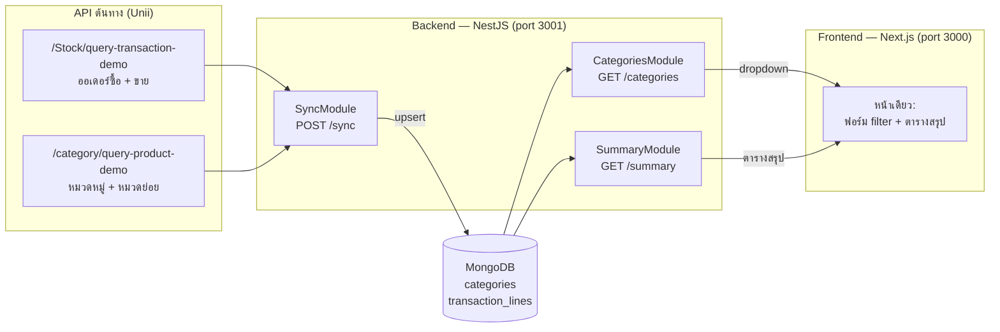
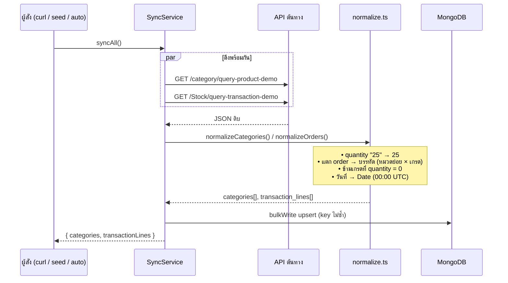
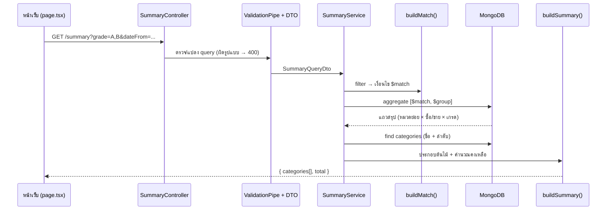
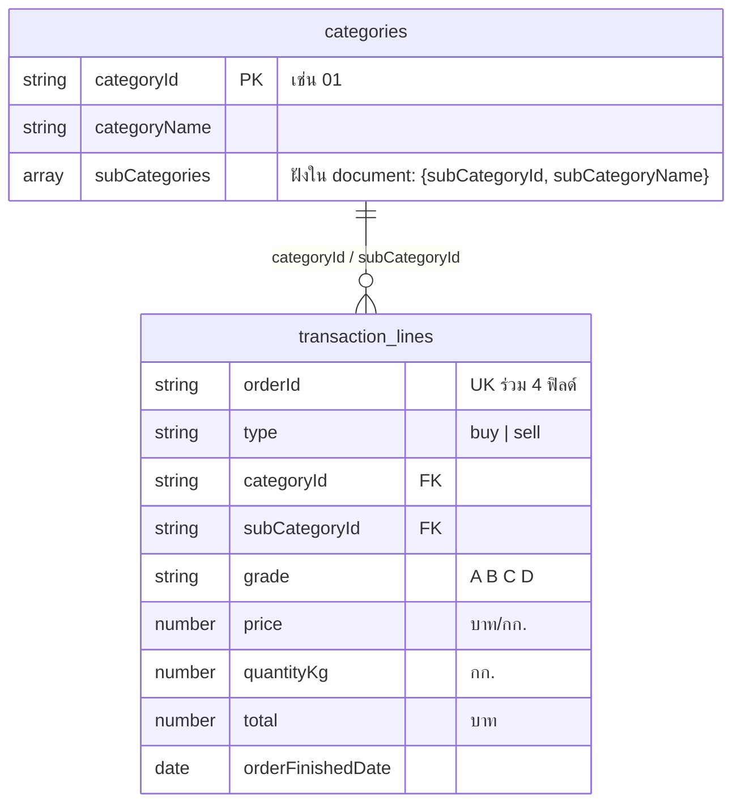
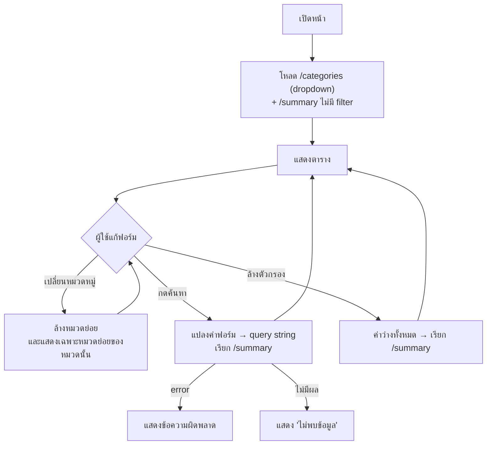

# Flow การทำงานของระบบ

เอกสารนี้อธิบาย "ข้อมูลไหลอย่างไร" ตั้งแต่ต้นทางจนถึงหน้าจอ แผนภาพเป็น [Mermaid](https://mermaid.js.org/) — เปิดอ่านบน GitHub/GitLab ได้ทันที

## 1) ภาพรวมระบบ

หลักการสำคัญ: **ระบบอ่านข้อมูลจาก MongoDB เท่านั้น** ไม่เรียก API ต้นทางตอนผู้ใช้เปิดหน้าเว็บ API ต้นทางถูกเรียกเฉพาะตอน sync

## 2) Flow การนำเข้าข้อมูล (Sync)

เกิดขึ้นเมื่อ: (ก) `POST /sync` (ข) `npm run seed` (ค) เปิด API ครั้งแรกใน docker-compose (`AUTO_SYNC=true` และ DB ว่าง)

**Idempotent:** สั่ง sync กี่ครั้งก็ได้ ข้อมูลไม่ซ้ำ เพราะ upsert ด้วย key `(orderId, type, subCategoryId, grade)`

## 3) Flow การค้นหา/สรุปยอด (Request)

## 4) โครงสร้างข้อมูลใน MongoDB

ตัวอย่าง: ออเดอร์ 1 ใบที่มี 2 หมวดย่อย หมวดละ 2 เกรด จะกลายเป็น **4 documents** ใน `transaction_lines`

## 5) Flow ฝั่งหน้าเว็บ

